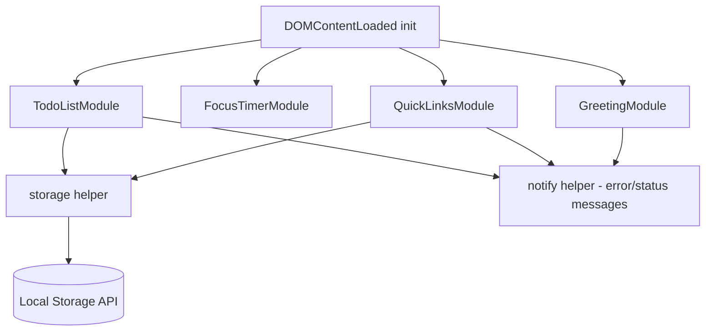
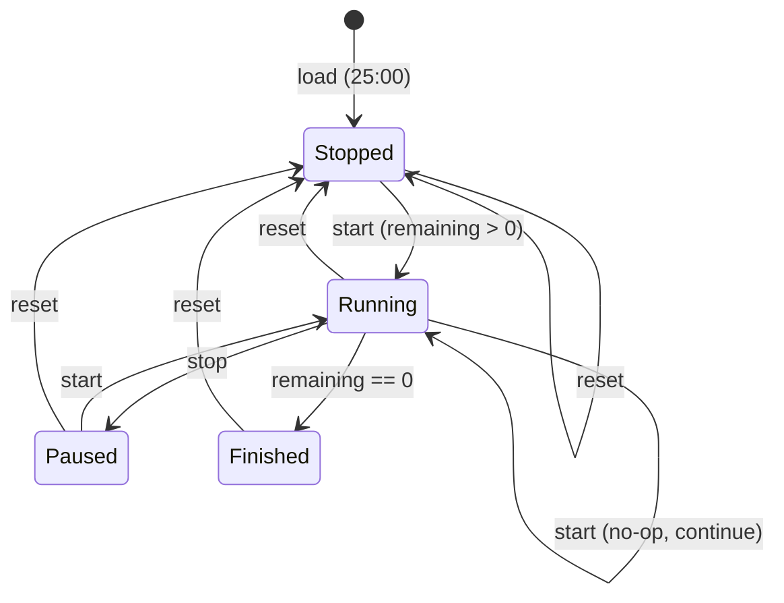

# Design Document

## Overview

The Todo List Life Dashboard is a single-page, client-side web application built entirely with HTML, one CSS file, and one vanilla JavaScript file. It runs in the browser with no backend and no third-party libraries. All persistent state (tasks and quick links) is stored through the browser Local Storage API.

The page presents four visually distinct, labeled sections on one screen:

1. **Greeting** — live time/date and a time-of-day greeting.
2. **Focus Timer** — a 25-minute countdown with start/stop/reset.
3. **To-Do List** — full task management (add, edit, complete, delete) with persistence.
4. **Quick Links** — user-configurable buttons that open websites, with persistence.

The design favors a small set of self-contained modules that share a tiny storage helper and a tiny DOM/render helper. Each module owns its in-memory state, its slice of Local Storage, and its own rendering. There is no shared global state object beyond what each module keeps internally, which keeps the single JavaScript file readable and the modules independent.

### Design Goals and Rationale

- **Framework-free simplicity (Req 12.1).** Plain functions and module objects rather than classes-everywhere; direct DOM APIs rather than a virtual DOM. This keeps the one-file JS small and understandable.
- **Separation by feature.** Each of the four features maps to one module. A module never reaches into another module's DOM or storage key. This makes the UI predictable and each section independently testable by hand.
- **Fail-soft persistence.** Local Storage can be unavailable (private mode, disabled, quota full). Every read is defensive (parse-or-discard) and every write is wrapped so a failure surfaces a user-visible error without crashing the session (Req 8.4, 8.5, 11.2, 11.5, 12.6).
- **Render-from-state.** For the To-Do List and Quick Links, the UI is always a function of the in-memory array. Mutations update the array, persist, then re-render. This avoids drift between stored data and what the user sees, and keeps per-interaction updates well under the 200 ms budget (Req 13.1, 13.2).

## Architecture

### High-Level Structure

```
index.html          Single page; four <section> elements, each with a heading
css/styles.css      The single stylesheet (Req 12.3)
js/app.js           The single script (Req 12.4)
```

`index.html` loads `css/styles.css` in the head and `js/app.js` at the end of the body (deferred). On `DOMContentLoaded`, `app.js` initializes the four modules in order.

### Module Map



### Shared Helpers (within js/app.js)

- **`storage`** — thin wrapper over `localStorage` exposing:
  - `isAvailable()` — feature-detects Local Storage (try a write/remove of a probe key inside try/catch).
  - `readJSON(key)` — returns `{ ok: true, value }` on success, `{ ok: false, reason }` when the key is missing, unreadable, or `JSON.parse` throws.
  - `writeJSON(key, value)` — returns `{ ok: true }` or `{ ok: false, reason }` when `setItem` throws (quota, disabled, unavailable).
- **`notify`** — renders a scoped status/error message into a given section's message area. Messages are text content (never `innerHTML` of user data) and are cleared on the next successful action.
- **`dom`** — small helpers: `el(tag, props, children)` to build elements, `clear(node)` to empty a node. Used so rendering stays declarative and avoids string-built HTML (which also keeps user text from being interpreted as markup).

### Initialization Flow

1. `storage.isAvailable()` is checked once. If unavailable, each persistent module (To-Do, Quick Links) starts with an empty in-memory collection and shows the "data cannot be saved" error, while all read-only features (greeting, timer) still work (Req 12.6).
2. Greeting module reads the clock, renders immediately, and starts a 1-second interval.
3. Focus Timer renders 25:00 in the stopped state.
4. To-Do List loads tasks from storage (or empty/empty-state) and renders.
5. Quick Links loads links from storage (or empty-state) and renders.

### Rationale: Why Modules Over a Single Controller

A single monolithic controller would couple the timer's interval, the clock's interval, and the two persisted collections into one state blob, making it easy for one feature's bug to corrupt another's rendering. Independent modules keep failure domains small: a storage read failure in Quick Links cannot affect the To-Do List, satisfying the "preserve in-memory state" requirements per feature.

## Components and Interfaces

### 1. GreetingModule

**Responsibility:** Display live local time and date; display a time-of-day greeting that updates on period boundaries.

**State:**
- `tickHandle` — interval id for the 1-second updater.
- `lastRenderedDateKey` — the last rendered calendar date (e.g. `YYYY-MM-DD`), used to avoid re-rendering the date string every second and to detect a date rollover (Req 1.3).
- `lastPeriod` — the last rendered Time_Of_Day, used to detect a period boundary crossing (Req 2.6).

**Interface:**
- `init()` — render once, then `setInterval(tick, 1000)`.
- `tick()` — read `new Date()`; update time every second; update date only when `lastRenderedDateKey` changes; update greeting only when the computed period differs from `lastPeriod`.
- `formatTime(date)` — `HH:MM:SS` via `Intl.DateTimeFormat` / `toLocaleTimeString` with the browser locale and 24h fields (hour, minute, second). (Req 1.1)
- `formatDate(date)` — weekday, month name, day number, four-digit year via `toLocaleDateString` with `{ weekday:'long', year:'numeric', month:'long', day:'numeric' }`. (Req 1.2)
- `classifyPeriod(date)` — pure function mapping the local hour to a Time_Of_Day. (Req 2.1-2.4)
- `greetingFor(period)` — returns a distinct label per period. (Req 2.5)

**Period classification (local hour `h`):**

| Period    | Condition           | Label (example)   |
|-----------|---------------------|-------------------|
| morning   | 5 ≤ h ≤ 11          | "Good morning"    |
| afternoon | 12 ≤ h ≤ 16         | "Good afternoon"  |
| evening   | 17 ≤ h ≤ 20         | "Good evening"    |
| night     | h ≥ 21 or h ≤ 4     | "Good night"      |

The four labels are distinct text so a reader can tell the active period from the greeting alone (Req 2.5). Because `tick` runs every second and compares `lastPeriod`, a boundary crossing is reflected within at most ~1 second, well inside the 60-second allowance (Req 2.6).

### 2. FocusTimerModule

**Responsibility:** A 25-minute (1500-second) countdown with start, stop, and reset.

**State:**
- `remaining` — integer seconds remaining (initial 1500).
- `isRunning` — boolean; `false` on load (Req 3.1).
- `intervalHandle` — interval id while running.

**Interface:**
- `init()` — set `remaining = 1500`, `isRunning = false`, render `25:00`.
- `start()` — guarded: only acts when `remaining > 0`. If already running, it is a no-op so the countdown continues uninterrupted (Req 3.7). Otherwise sets `isRunning = true` and starts a 1-second interval.
- `stop()` — clears the interval, sets `isRunning = false`, retains `remaining` (Req 3.4).
- `reset()` — clears any interval, sets `remaining = 1500`, `isRunning = false`, renders (Req 3.5).
- `onTick()` — decrement `remaining` by 1; if it reaches 0, clear the interval and set `isRunning = false` (Req 3.6); render.
- `render()` — formats `remaining` as `MM:SS`.

**State transitions:**



**Timing accuracy (Req 3.3):** The interval is `setInterval(onTick, 1000)`. A plain decrement each tick keeps the display within the ±100 ms tolerance for the display cadence under normal conditions. (Drift correction against wall-clock time is not required by the acceptance criteria and is intentionally omitted to keep the module simple.)

**Note:** The Focus Timer is intentionally **not persisted**. No requirement asks for timer state to survive reload, and keeping it in memory avoids resuming a stale countdown.

### 3. TodoListModule

**Responsibility:** Manage the task collection — add, edit, complete/incomplete, delete — and persist it.

**State:**
- `tasks` — ordered array of Task objects (see Data Models).
- `editingId` — id of the task currently in edit mode, or `null`.

**Interface:**
- `init()` — load from storage, render.
- `load()` — `storage.readJSON(TASKS_KEY)`; on `ok` validate shape and adopt the array (preserving order and completion state, Req 8.2); on missing key use `[]` (Req 8.3); on parse/read failure use `[]` and show the "saved tasks could not be loaded" error (Req 8.4).
- `add(rawText)` — validate; on success push a new Task, persist, clear input, render (Req 4.1, 4.2); on failure show the appropriate validation error and leave state unchanged (Req 4.3, 4.4).
- `beginEdit(id)` — set `editingId`, render the row with a pre-populated input (Req 5.1).
- `confirmEdit(id, rawText)` — validate; on success replace description, persist, exit edit mode, render (Req 5.2); on failure keep previous description and show error, staying in edit mode (Req 5.3, 5.4).
- `cancelEdit()` — clear `editingId`, render original description (Req 5.5).
- `toggleComplete(id)` — flip completion; persist; if persist fails, revert to prior state and show error (Req 6.1-6.5).
- `remove(id)` — if the id is not present, show "task could not be found" and change nothing (Req 7.3); otherwise remove, persist, render; if none remain, show empty-state (Req 7.1, 7.2, 7.4).
- `persist()` — `storage.writeJSON(TASKS_KEY, tasks)`; on failure keep in-memory tasks displayed and show the "change could not be saved" error (Req 8.5). Called within 1 s of each mutation (synchronously after the mutation), satisfying Req 8.1.
- `render()` — rebuild the list from `tasks`; apply the completed visual class per task (Req 6.3, 6.4); show empty-state message when `tasks.length === 0`.

**Validation (shared by add and edit):**
- Trim leading/trailing whitespace for the emptiness check.
- Reject if the trimmed text has 0 non-whitespace characters → "A description is required." (Req 4.3, 5.3)
- Reject if the total length exceeds 200 characters → "Description must be 200 characters or fewer." (Req 4.4, 5.4)
- On success the stored description is the entered text (trimmed).

**Completion revert detail (Req 6.5):** `toggleComplete` flips the flag in memory, then persists. If `persist()` returns `{ ok: false }`, the flag is flipped back and an error is shown, so the displayed state matches what is actually stored.

### 4. QuickLinksModule

**Responsibility:** Render a button per stored link, open links in a new tab, add/remove links, and persist them.

**State:**
- `links` — ordered array of Quick_Link objects (see Data Models).

**Interface:**
- `init()` — load from storage, render.
- `load()` — `storage.readJSON(LINKS_KEY)`; on `ok` validate shape and adopt in saved order (Req 11.3); on missing key use `[]` (Req 11.4); on malformed/unparseable data use `[]` and discard the bad stored value (Req 11.5).
- `add(rawLabel, rawUrl)` — validate; on success push a Quick_Link, persist, render; on failure reject, keep the input values, and show a field-specific error (Req 10.1, 10.3, 10.4, 10.5).
- `remove(id)` — remove the link, persist, render (Req 10.2).
- `open(id)` — resolve the link; if URL missing/malformed, show "link is invalid" and do not open (Req 9.4); otherwise `window.open(url, '_blank', 'noopener')` (Req 9.3).
- `persist()` — `storage.writeJSON(LINKS_KEY, links)`; on failure keep in-memory links and show "quick links could not be saved" (Req 11.2). Satisfies Req 11.1 by running synchronously after each add/remove.
- `render()` — one button per link; button text is the label truncated to 30 characters with a trailing ellipsis when longer (Req 9.1); show the "no quick links" message and render no buttons when `links.length === 0` (Req 9.2).

**Validation (Req 10.1, 10.3, 10.4):**
- **Label:** trim; must be 1-50 characters after trimming, else "Label must be 1-50 characters."
- **URL:** must be non-empty, at most 2048 characters, and parse via `new URL(value)` with protocol `http:` or `https:`; otherwise "Enter a valid http or https URL." The `URL` constructor provides well-formedness checking without a library.

**Label truncation vs. storage:** The full label (up to 50 chars) is stored; truncation to 30 chars with an ellipsis is a display-only transform in `render()`.

## Data Models

### Task

```js
// Stored under localStorage key "tldd.tasks" as a JSON array
{
  id: string,          // unique id (e.g. crypto.randomUUID() or timestamp+counter)
  description: string, // 1-200 chars, trimmed on save
  completed: boolean    // completion state
}
```

### Quick_Link

```js
// Stored under localStorage key "tldd.links" as a JSON array
{
  id: string,     // unique id
  label: string,  // 1-50 chars (trimmed); display truncates to 30 chars
  url: string     // http/https, 1-2048 chars
}
```

### Storage Keys

| Key          | Shape            | Owner             |
|--------------|------------------|-------------------|
| `tldd.tasks` | `Task[]` as JSON | TodoListModule    |
| `tldd.links` | `Quick_Link[]`   | QuickLinksModule  |

### Shape Validation on Load

Both modules validate loaded data before adopting it. An entry is kept only when it is an object with the expected field types (strings for text fields, boolean for `completed`). If the top-level value is not an array, the whole payload is treated as malformed → empty collection (plus error for tasks per Req 8.4; silent discard for links per Req 11.5). This guards against hand-edited or corrupted storage.

## Error Handling

Errors are surfaced per section via the `notify` helper into a dedicated message area inside that section. Messages are plain text and cleared on the next successful action.

| Condition | Requirement | Behavior |
|-----------|-------------|----------|
| Local Storage unavailable at startup | 12.6 | Persistent modules start empty in memory; show "data cannot be saved" error; read-only features continue. |
| Task write fails (quota/disabled) | 8.5, 12.6 | Keep current tasks in display; show "change could not be saved." |
| Task read fails / invalid JSON | 8.4 | Display empty list; show "saved tasks could not be loaded." |
| No task data stored | 8.3 | Empty list, no error. |
| Add/edit task invalid (empty) | 4.3, 5.3 | No change; show "a description is required"; edit mode retained. |
| Add/edit task invalid (too long) | 4.4, 5.4 | No change; show max-length error; edit mode retained. |
| Toggle complete persist fails | 6.5 | Revert completion flag; show error. |
| Delete non-existent task | 7.3 | No change; show "task could not be found." |
| Delete last task | 7.4 | Show empty-state message. |
| Link write fails | 11.2, 12.6 | Keep in-memory links; show "quick links could not be saved." |
| Link data malformed | 11.5 | Empty set; discard malformed value (no error required). |
| No link data stored | 11.4 | Empty set, show "no quick links" message. |
| Add link invalid label | 10.3 | Reject; retain input values; show label error. |
| Add link invalid URL | 10.4 | Reject; retain input values; show URL error. |
| Open link with missing/malformed URL | 9.4 | Do not open; show "link is invalid." |

**Principle:** No error path mutates stored data destructively except the explicit "discard malformed links" case (Req 11.5). In-memory state is always preserved on write failure so the session can continue (Req 12.6).

## Presentation and Responsive Design

- **Four labeled sections (Req 13.3):** Each feature is a `<section>` with an `<h2>` heading, giving four visually distinct, labeled regions. Sections are separated by spacing, borders/background, and headings.
- **Typography and contrast (Req 13.4):** Base `font-size` is set to at least 14px on `body`; the chosen foreground/background color pairs are selected to meet at least 4.5:1 contrast. (Full WCAG conformance would require manual verification with a contrast tool; the design commits to compliant default pairs.)
- **Responsive layout (Req 13.5):** A fluid layout (CSS flexbox/grid with wrapping and `max-width` containers, `box-sizing: border-box`, and no fixed widths wider than the smallest viewport) keeps all four sections visible without horizontal scrolling or overlap from 320px to 1920px. A single breakpoint can switch from a single column (narrow) to a multi-column arrangement (wide).
- **Update performance (Req 13.1, 13.2):** Task and Quick Link updates re-render only the affected section's list from the in-memory array using direct DOM construction. These operations are O(n) over a small collection and complete well within 200 ms. Avoiding `innerHTML` string parsing of user data also keeps rendering fast and safe.

## Testing Strategy

Per NFR-1 ("No test setup required"), this project does **not** include an automated test harness, test framework, or property-based testing setup. Verification is lightweight and manual.

**Why no property-based testing:** The dashboard is overwhelmingly UI rendering, timer/interval side effects, `window.open`, and Local Storage persistence — categories not suited to property-based testing. The explicit "no test setup" constraint also rules out adding a test runner or PBT library.

**Manual verification checklist (per feature, in a browser):**

- **Greeting:** Time ticks each second in `HH:MM:SS`; date shows weekday/month/day/year in locale format; greeting label matches the current period and changes at a boundary (can be checked by temporarily overriding the system clock or the hour used by `classifyPeriod`).
- **Focus Timer:** Loads at 25:00 stopped; start counts down; stop pauses and retains; start resumes; reset returns to 25:00 stopped; reaching 0 stops at 00:00; pressing start while running does not restart.
- **To-Do List:** Add with valid/empty/whitespace/>200-char input; edit with confirm/cancel and the same validation; toggle complete/incomplete shows/removes the visual state; delete removes and shows empty-state when none remain; reload preserves order and completion; corrupt the stored JSON manually to confirm the load error and empty list.
- **Quick Links:** Add with valid/invalid label and URL (retain inputs on rejection); labels longer than 30 chars truncate with ellipsis in the button; empty-state message with no links; clicking opens the URL in a new tab; remove deletes; reload preserves order; corrupt stored JSON to confirm it is discarded to an empty set.
- **Cross-cutting:** Resize the viewport across 320-1920px to confirm no horizontal scroll or overlap; confirm four labeled sections; simulate Local Storage failure (e.g., disable storage or fill quota) to confirm the "cannot be saved" error appears while in-memory state is preserved.

**Browser coverage (Req 12.5):** Smoke-test the checklist in the latest stable Chrome, Firefox, Edge, and Safari.
